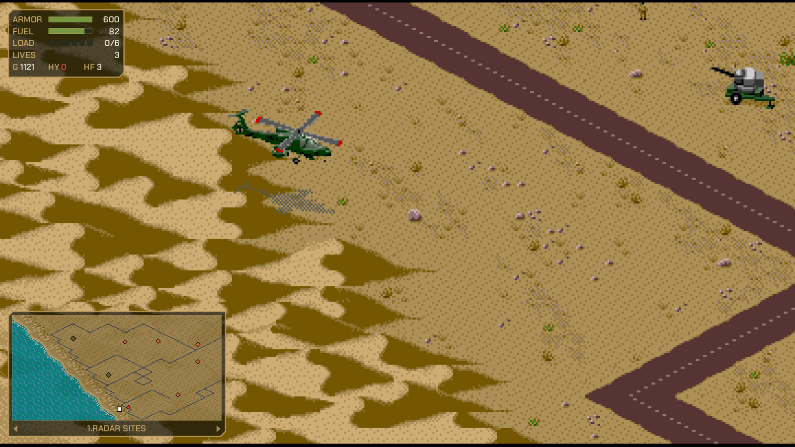
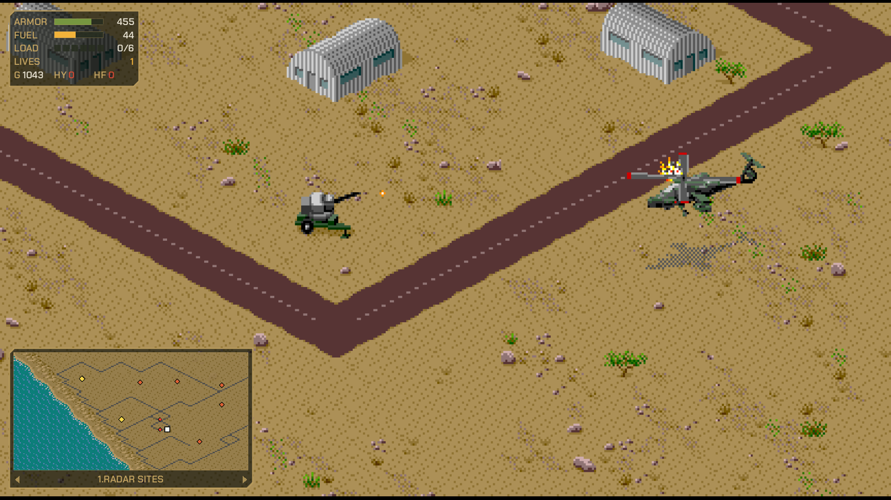
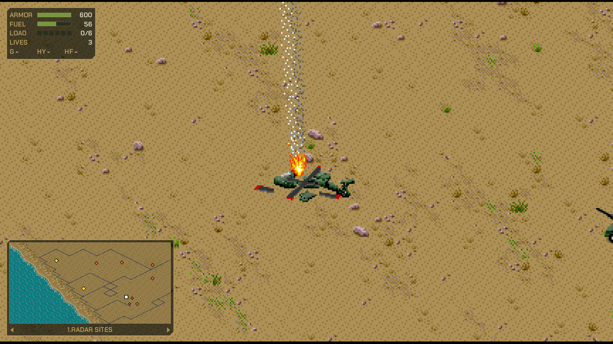
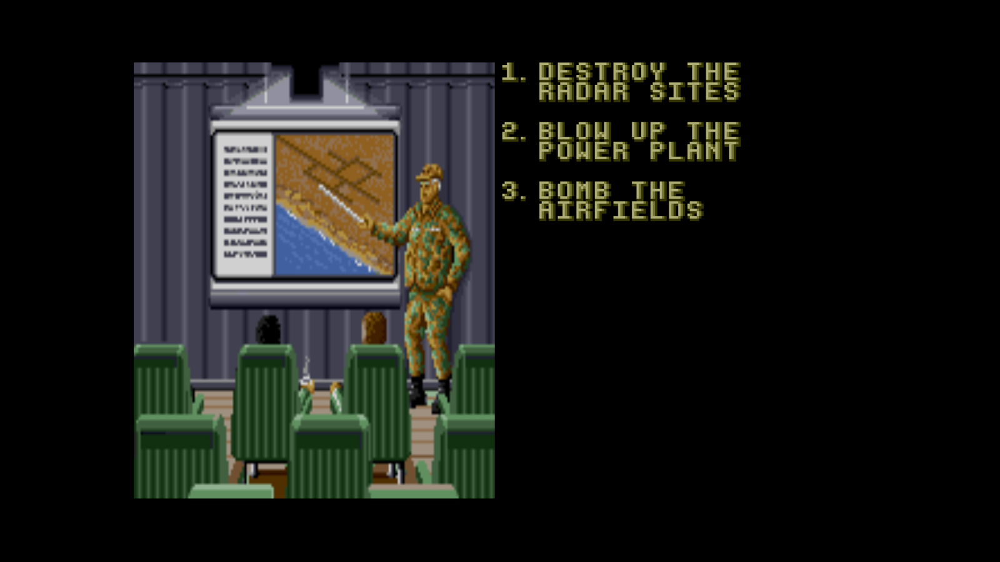
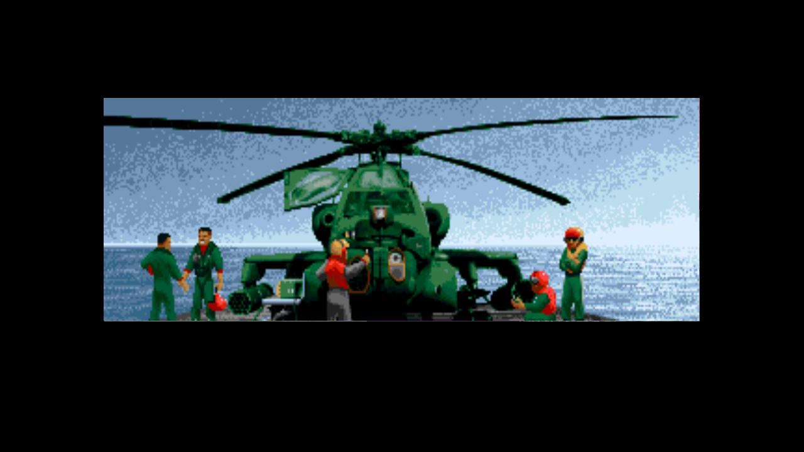
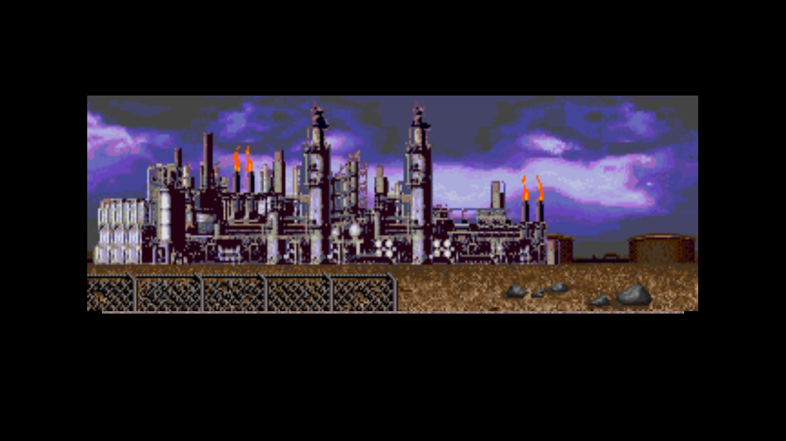
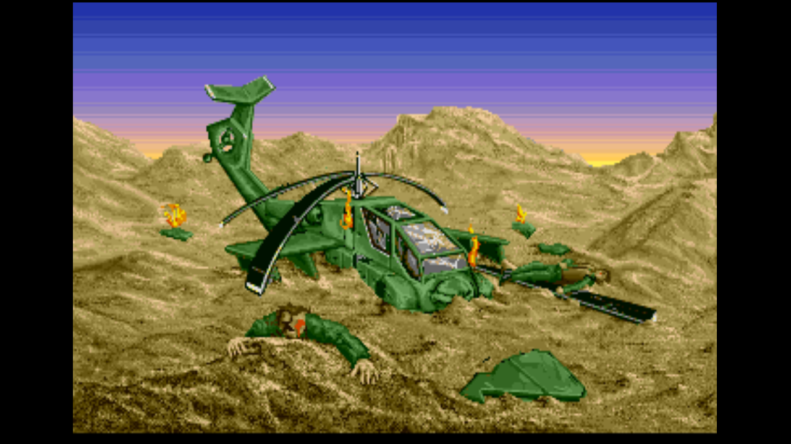
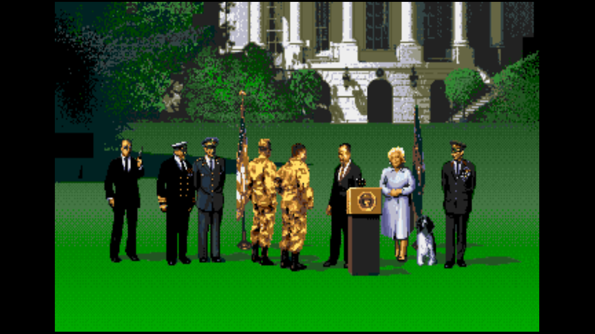

# Strike Remastered Collection HD

Native PC versions of the three Sega Genesis Strike games: *Desert Strike: Return to the Gulf* (1992), *Jungle Strike* (1993) and *Urban Strike* (1994). They are static recompilations, with modern features added:

- **The original game code, recompiled to C.** It is verified instruction-exact against a reference 68000 emulator (the Musashi core) in lockstep tests. Sound is the real YM2612/PSG hardware, emulated with ymfm.
- **Widescreen**: 16:10, 16:9, 21:9 and 32:9, plus "Match window". The battlefield is drawn from each game's own map data beyond the console's 512-pixel limit. Menus, maps and cutscenes stay 4:3.
- **HD graphics packs**, with a one-click builder. The game extracts its own graphics, upscales them 4× with xBRZ (keeping dithered textures crisp), and loads the result.
- **Status HUD**: armor, fuel, load, lives and ammo.
- **Minimap and status HUD**: each in any corner and at any size. The minimap is the pause map, live, with the objectives (and, optionally, nearby enemy guns); LB / RB (Q / E) step through them like the pause menu.
- **Pause menu**: save/load slots with thumbnails, full keyboard and gamepad rebinding, display, picture, audio and system settings.
- **Cheats**: god mode, unlimited fuel, ammo and lives, campaign select.
- **Rewind** (hold the left trigger), **autosave** on mission start and each completed objective, **gamepad rumble**, and **career stats**.
- **Game Speed**: Smooth (no slowdown) or Original (the console's slowdown).
- **CRT filter (prototype)**: the [Lola Retro](https://github.com/zoran123456/lola-retro) shaders simulate a real TV or monitor, from the console's video signal to the glass, widescreen included (Settings → CRT; OpenGL renderer). See `docs/15-crt-filter.md`.
- **Difficulty (prototype, Desert Strike)**: chosen on New Game. *Remastered* keeps the full speed and every bullet on screen but rebalances the damage (bullets sting less than missiles, and a crossfire can't empty your armour in an instant); *Recruit* is gentler; *Original* is the Genesis as shipped, slowdown included. See `docs/14-difficulty.md`.
- **Launcher**: the games' intros play live behind a gamepad-friendly game picker, and a Continue / Load Game / New Game screen picks up where you left off.
- **Amiga edition for Desert Strike (work in progress)**: add your own Amiga Desert Strike disks and the game can use the Amiga's sound effects (weapons, rotor that follows your speed, rescue calls, voice lines), its ProTracker music, its title photos, and its cutscenes, including the animated ones, which run as the original Amiga programs in a small built-in Amiga emulator. Pick Genesis, Amiga or a mix under Settings → Audio → Edition. The mapping of sounds is still being tuned; the **Sound Lab** and `tools/amiga/sound_labeler.html` let you choose your own.
- **Installer**: Inno Setup, with a ROM page that checks your dumps.

**No game data is included.** You need your own ROM dumps. They are checked by SHA-1:

| Game | SHA-1 (USA/Europe) |
|---|---|
| Desert Strike: Return to the Gulf | `d7e7d8c358eb845b84fb08f904cc0b95d0a4053d` |
| Jungle Strike | `7a7568e39341b1bb218280ee05c2b37c273317b5` |
| Urban Strike | `897a8f6a08d6d7d6e5316f8047532b3e4603e705` |

The recompiled C (`generated/`) is produced from your ROM on your machine and is not part of this repository.

## Screenshots
| | |
|---|---|
|  |  |
|  |  |
|  |  |
|  |  |

Gameplay is 16:9 widescreen with the status HUD and minimap. The Amiga pictures need your own Amiga disks.

## Download
The Windows installer and a portable zip are on the [Releases](https://github.com/Icedomega13/StrikeHDCollection/releases) page. Both need your own ROMs.

## Playing
1. Run the installer, or `StrikeCollectionHD.exe`. Point it at your ROMs; they are copied to `%APPDATA%\DesertStrikeHD\DesertStrikeHD\roms\`.
2. Pick a game. **Settings** on the game picker, or **Esc / Back** in game, opens the menu.

| Genesis | Keyboard | Gamepad |
|---|---|---|
| D-pad | Arrows / WASD | D-pad / left stick |
| A / B / C | J K L or Z X C | West / South / East |
| Start | Enter | Start |

Host keys:
- **F5 / F7:** quick save / load.
- **F11** or **Alt+Enter:** fullscreen.
- **Tab** or **right trigger:** fast forward.
- **Q / E** or **LB / RB:** step through the objectives on the minimap.
- **Backspace** or **left trigger** (hold): rewind.
- **Left Shift** or **Y** (hold): strafe, Desert Strike's hold-A sidestep, without firing a Hellfire. Press A while strafing to fire a Hellfire and keep strafing. The right stick strafes too (left or right). **Strafe Speed** (Settings > System) can make the sidestep 1.5x or 2x faster.
- **M**, or hold **Esc / Back**: show or hide the minimap.
- **Esc** or **Back:** pause menu.

Everything can be rebound under **Controls**.

**Amiga edition:** Settings → Audio → **Add Amiga Disks**, and choose your Amiga *Desert Strike* `.adf` files (they are copied to `%APPDATA%\DesertStrikeHD\DesertStrikeHD\amiga\`). Nothing from the Amiga version is included. See `docs/13-amiga-ultimate.md`.

**HD graphics:** Settings → System → **Build HD Pack**, once per game. It takes a few minutes. See `docs/09-hd-packs.md`.
On Linux, choose the rendering backend in Settings → Display → **Renderer (restart)**. OpenGL (GPU) is the default; enable **Show FPS** to see the active SDL renderer. Software rendering remains available as a fallback.

## Building
### Linux (Ubuntu/Debian)

Install the compiler, CMake, SDL3 development files, and Python tooling:

```sh
sudo apt update
sudo apt install build-essential cmake python3 python3-venv python3-pip libsdl3-dev
```

Create a virtual environment for the ROM analysis tools and install their Python dependencies:

```sh
python3 -m venv .venv
. .venv/bin/activate
python -m pip install --upgrade pip
python -m pip install capstone pillow
```

Place your own supported ROM dumps in `rom/` as `desert_strike.bin`, `jungle_strike.bin` and `urban_strike.bin`. Then generate each game's C source and build the launcher:

```sh
python tools/trace.py --game desert
python tools/recomp.py --game desert
python tools/trace.py --game jungle
python tools/recomp.py --game jungle
python tools/trace.py --game urban
python tools/recomp.py --game urban

cmake -S . -B build -DDS_SYSTEM_SDL=ON -DDS_BUILD_TESTS=OFF -DCMAKE_BUILD_TYPE=Release
cmake --build build --parallel
```

The executable is `build/StrikeCollectionHD`; the HD pack upscaler is `build/hdpack_xbrz`. `DS_SYSTEM_SDL=ON` uses the installed SDL3 package. To let CMake fetch and build SDL3 instead, omit that option; this requires network access during configuration and SDL's Linux development dependencies.

The generated game sources are derived from the ROMs and are not committed. Keep the Python virtual environment active when running the trace and recompilation tools.

### Windows

Requirements:
- Python 3.10+ with `capstone` and `pillow`;
- CMake 3.16+;
- a C/C++17 compiler (Visual Studio 2022, MinGW/llvm-mingw, gcc or clang).

```
copy "<your roms>" rom\desert_strike.bin, rom\jungle_strike.bin, rom\urban_strike.bin
python tools/trace.py  --game desert   (and jungle, urban)
python tools/recomp.py --game desert   (and jungle, urban)
cmake -S . -B build
cmake --build build --config Release
```

- CMake downloads SDL3 if `third_party/SDL3` is missing.
- Outputs:
  - `StrikeCollectionHD`: the game.
  - `hdpack_xbrz`: the HD pack upscaler.
  - `ds_test` and `ds_ref` (with `-DDS_BUILD_TESTS=ON`): the headless recompiled build and the Musashi reference.
- **Cross-compiling for Windows from Linux:** add `-DCMAKE_TOOLCHAIN_FILE=cmake/mingw-w64-x86_64.cmake -DMINGW_ROOT=<llvm-mingw>`.
- **Installer:** install Inno Setup 6, put the built programs in `dist\`, then run `installer\build_installer.bat`.

## Testing
```
tools/lockstep_suite.sh build      # every game and scenario, recompiled vs Musashi, frame by frame
```
For headless runs of the game: `StrikeCollectionHD <rom> --frames N --inputs file --shot-every N dir`. To extract graphics for all games: `--extract`.

## Layout
```
games/<id>/        per-game config (game.json, hints.json: jump tables, patches) and module
games/strike_*     shared Strike-engine code: playfield test, ultrawide map painter, HUD, cheats
src/hw/            Genesis hardware: bus, VDP + renderer (incl. HD compose), Z80, YM2612, PSG
src/runtime/       CPU state, dispatch, interrupts, frame stepping, test runner
src/host/          SDL3 program: launcher, menus, input, settings, HD packs, extractor
tools/             tracer, recompiler, lockstep tools, xBRZ pack tool, helpers
harness/           Musashi reference runner + input scripts
installer/         Inno Setup script
docs/              design notes and findings (start with docs/HANDOFF.md)
```

## How it was made
This project was developed with heavy use of AI: the reverse engineering, recompiler, PC host and features were written by Anthropic's Claude, working with the project's maintainer, who directs, tests and plays it. The recompiled code is checked instruction for instruction against an independent 68000 emulator (see Testing), so the games run exactly as on the console.

## License
The project's own code is under the MIT license (`LICENSE`). Third-party components keep their own licenses (below).

## Third-party
- Musashi 68000 core (MIT): the lockstep reference, and the CPU of the built-in Amiga that runs the Amiga cutscene programs.
- ymfm (BSD-3, Aaron Giles).
- z80 by Nicolas Allemand (MIT; one local fix: `BIT n,(HL)` no longer writes back).
- SDL3 (zlib).
- stb_image, stb_image_write, stb_truetype (public domain / MIT).
- Chakra Petch font (SIL OFL 1.1).
- Lola Retro CRT shaders (MIT, Zoki), the GLSL port in `third_party/lola-retro`: the CRT filter.
- Capstone (BSD), used by the tools only.
- xBRZ (GPL-3, Zenju). It is used only in the separate `hdpack_xbrz` tool; see `tools/xbrz/License.txt`.

*Desert Strike*, *Jungle Strike* and *Urban Strike* are trademarks of Electronic Arts. This is an unofficial fan project, not affiliated with or endorsed by EA or Sega.
